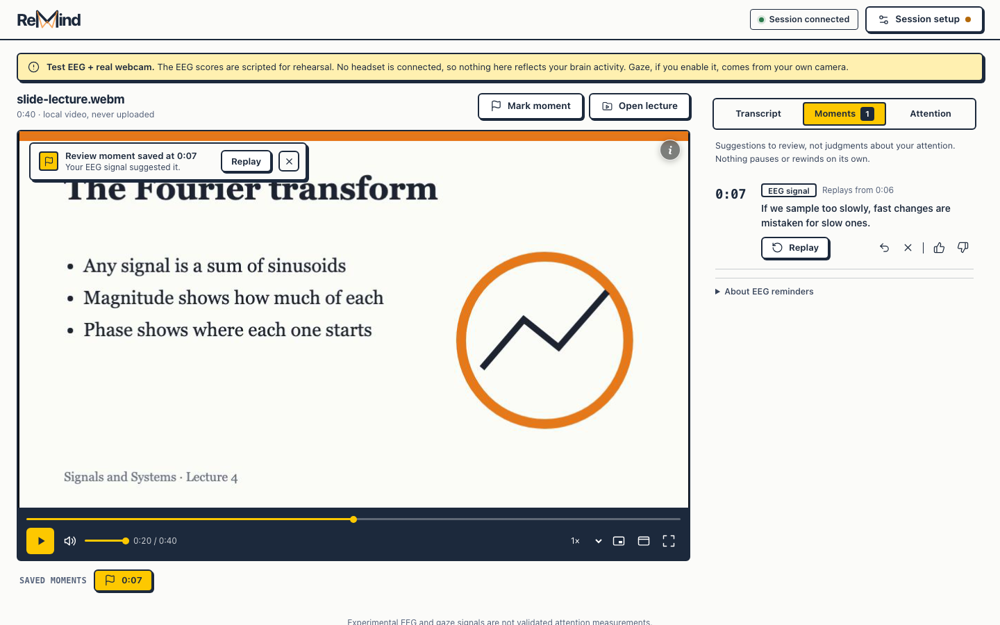
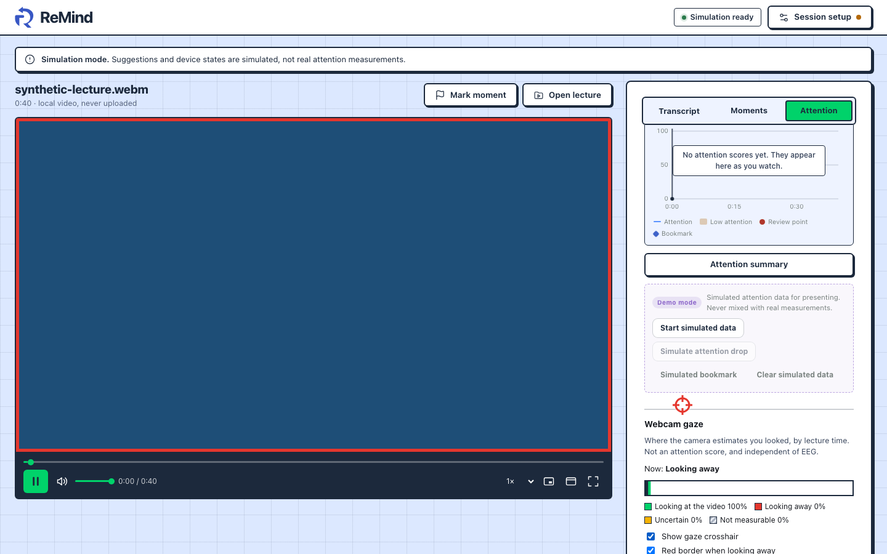
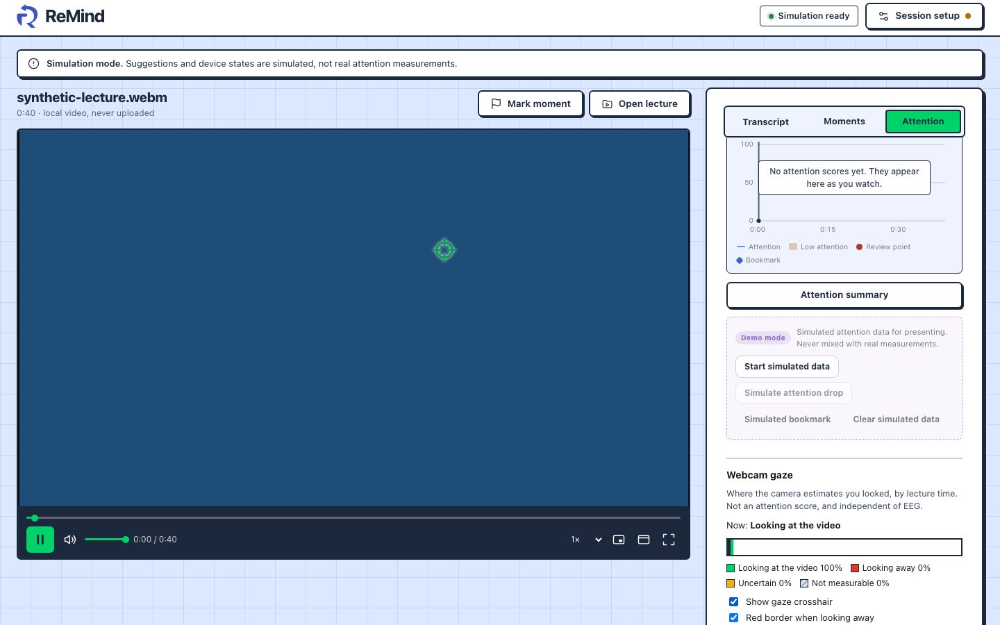

# ReMind

**A lecture player that helps you find the moment you lost the thread.**
Built at the Oxford neurotech hackathon by a team of six.



You open a recorded lecture, and ReMind watches for signs that your attention
slipped, using an EEG headset and your webcam. When it spots one, it saves a
**review moment**. You can replay that passage in context, with the transcript
aligned to it, whenever you like. Nothing pauses or rewinds on its own, and the
suggestions are for review, not judgments about you.

> **Status: research prototype.** The EEG and gaze signals are experimental and
> are not validated attention measurements. When the EEG is scripted for
> rehearsal, the app says so on screen. See [PRODUCT.md](PRODUCT.md).

## What's in it

- **Player.** Local video and `.vtt` transcript, manual bookmarks, replay of a
  time range. The video never leaves your browser.
- **EEG.** Acquisition, preprocessing, quality checks and feature extraction
  ([`eeg/`](eeg/)).
- **Webcam gaze.** In-browser face landmarks, a 15-dot calibration with a
  held-out accuracy check, and a gaze estimate for whether you are looking at
  the lecture ([`gaze/`](gaze/)). Uncertain or lost frames are never counted as
  "looking away".
- **Inference.** Combines the signals into review events, with explicit
  *unknown* and *interrupted* states ([`inference/`](inference/),
  [`evaluation/`](evaluation/)).
- **Platform.** A FastAPI service that maps clocks between devices and carries
  schema-validated messages ([`platform/`](platform/), [`contracts/`](contracts/)).

| Looking away: red border and crosshair | Gaze over the lecture timeline |
|---|---|
|  |  |

The gaze screenshots use a stand-in camera. They show the interface, not a
real person's gaze.

## Privacy

- Camera frames and EEG samples are never stored.
- Calibration is kept in the browser only.
- The repository contains synthetic fixtures only: no recordings of real
  sessions, and no personal data.

## Run it

Needs Node 22.12+, Python 3.11+ and [`uv`](https://docs.astral.sh/uv/).

```bash
npm run setup       # install frontend and platform dependencies
npm run dev:focus   # start the platform and the ReMind player
```

Without a headset or camera, the app runs in a clearly labelled simulation
mode. Webcam gaze needs camera permission.

Tests: `npm run e2e` runs the browser suite, and `npm run contracts:check`
verifies the shared message schemas.

## Layout

| Folder | What it holds |
|---|---|
| `frontend/` | React 19 + TypeScript + Vite app: player, review timeline, onboarding |
| `eeg/` | EEG pipeline (Python) |
| `gaze/` | Webcam gaze engine and calibration |
| `inference/`, `evaluation/` | Signal combination, event logic, offline evaluation |
| `platform/`, `contracts/` | FastAPI service, shared schemas and fixtures |
| `integration/` | Replay harness for end-to-end tests |
| `docs/` | Timing, replay, security and design notes |

Team workflow and ownership are in [AGENTS.md](AGENTS.md) and
[CONTRIBUTING.md](CONTRIBUTING.md).

## Licence

[MIT](LICENSE).
