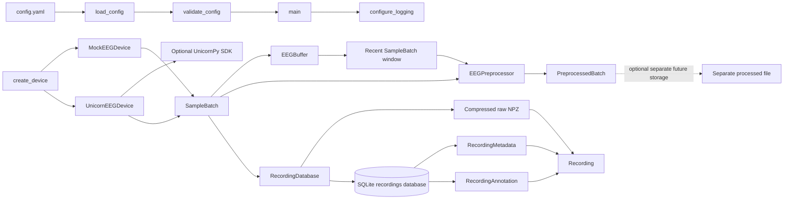

# EEG project architecture

This document describes how the implemented objects interact. It should be
updated whenever a new subsystem or public object changes the data flow.

## System graph

## Runtime data flow

1. `main` loads and validates the YAML configuration and configures logging.
2. A caller asks `create_device` for either a development mock device or the
   optional Unicorn adapter.
3. The selected device produces ordered `SampleBatch` objects.
4. `EEGBuffer` can retain a recent bounded window for analysis while
   preserving timestamp/index alignment.
5. `EEGPreprocessor` receives batches or windows and returns
   `PreprocessedBatch` objects. Its causal SciPy filter state continues across
   consecutive calls.
6. `RecordingDatabase.create_recording` persists the original acquired
   `SampleBatch` as a compressed NPZ and stores searchable metadata in
   SQLite.
7. Annotations reference the recording and use global sample indices.

## Important boundaries

### Raw versus processed data

The raw `SampleBatch` is the primary dataset and must remain unchanged.
`EEGPreprocessor` output is a separate representation. A future processed-data
writer must use a separate path and explicit metadata; it must never overwrite
the raw NPZ.

### Device versus processing

Devices only acquire and describe samples. They do not filter signals,
calculate quality metrics, or estimate attention.

### Processing versus attention

The buffer and preprocessor do not calculate attention features or scores.
Future attention code should consume explicitly documented processed data.

### Database versus files

SQLite stores metadata and references. NPZ stores numeric arrays. Creation uses
an atomic file move before the database insert, and failure paths clean up
temporary files.

## Documentation maintenance

When adding an object:

1. Add its object-level contract to
   [OBJECT_REFERENCE.md](OBJECT_REFERENCE.md).
2. Add or update its node and edges in this architecture graph.
3. Document whether it consumes raw or processed data.
4. Add tests for persistence, ordering, lifecycle, or state boundaries as
   appropriate.
